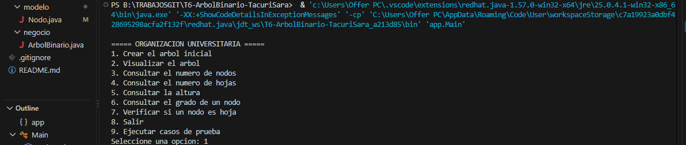
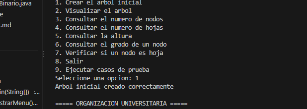
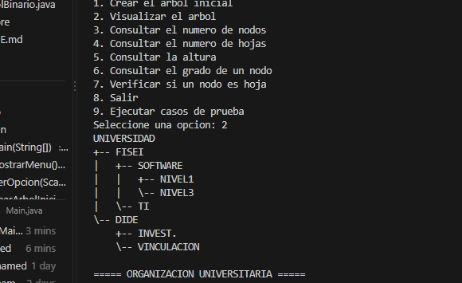
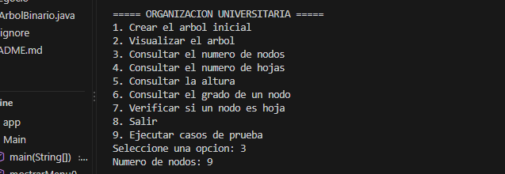
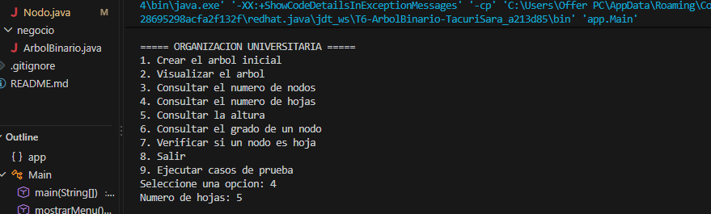
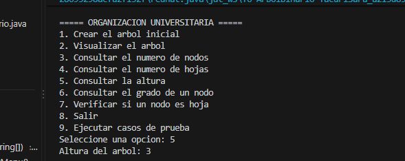
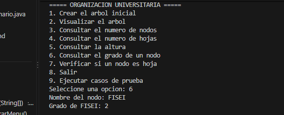
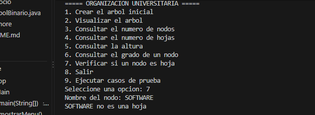
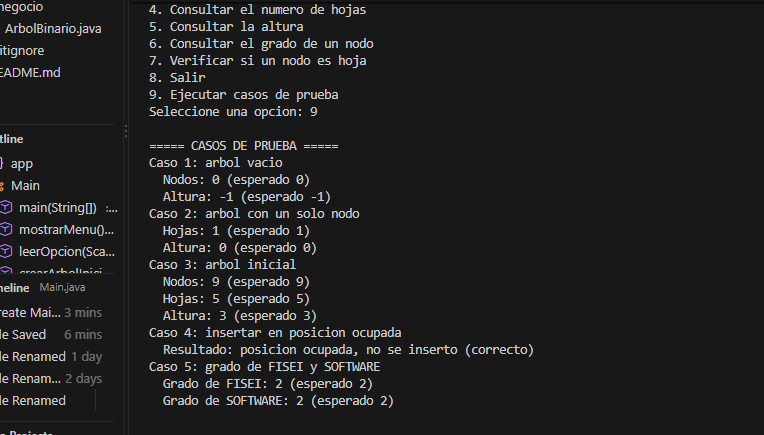

# T6 - Arbol Binario en Java

Asignatura: Estructura de Datos
Estudiante: [Monica Tacuri]

## Problema
Sistema que representa la organizacion jerarquica de los departamentos de la Universidad mediante un arbol binario. Cada nodo guarda el nombre de una dependencia y tiene como maximo dos hijos.

## Estructura del arbol
```
UNIVERSIDAD
+-- FISEI
|   +-- SOFTWARE
|   |   +-- NIVEL1
|   |   \-- NIVEL3
|   \-- TI
\-- DIDE
    +-- INVEST.
    \-- VINCULACION
```
El arbol tiene 9 nodos, 5 hojas y una altura de 3 aristas.

## Organizacion del proyecto
```
src/
 |-- modelo/Nodo.java
 |-- negocio/ArbolBinario.java
 \-- app/Main.java
```

## Instrucciones de ejecucion
```
javac -d out src/modelo/Nodo.java src/negocio/ArbolBinario.java src/app/Main.java
java -cp out app.Main
```

## Resultados

### Menu principal


### Visualizacion del arbol



### Nodos, hojas y altura




### Grado de un nodo y verificacion de hoja



### Casos de prueba
